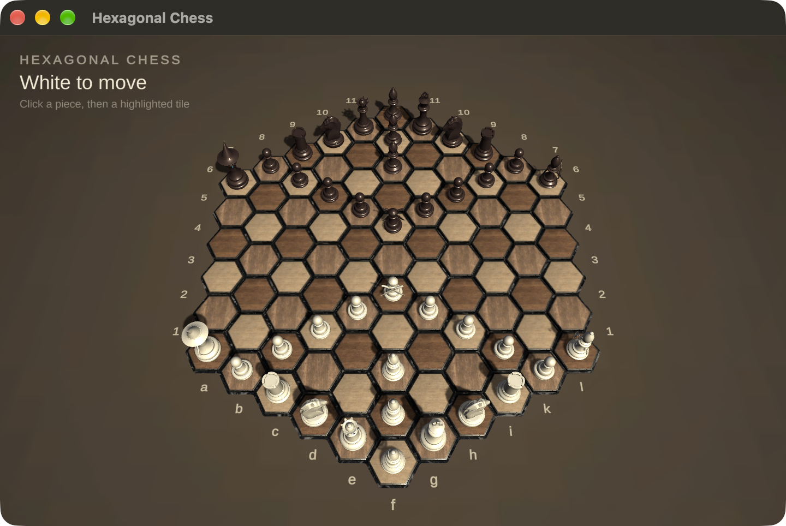
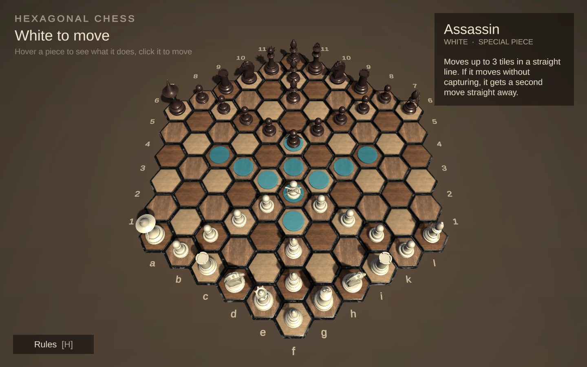
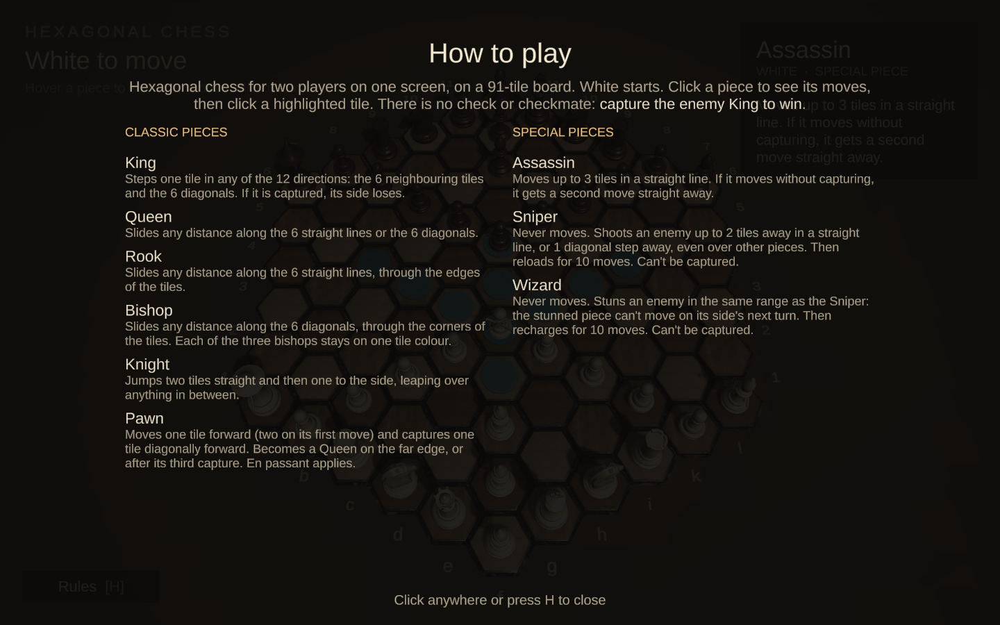

# Hexagonal Chess

A two-player chess game on a 91-tile hexagonal board, built in Unity. Besides the classic pieces, each side gets three
of its own: an **Assassin**, a **Sniper** and a **Wizard**.

**[Play it in the browser](https://pavelholman.github.io/hexagonal-chess/)** (desktop, mouse)

## How it plays

Two players take turns on one screen. Click a piece to see where it can go, then click a highlighted tile. There is no
check or checkmate: **capture the enemy King to win**. Hover any piece to see what it does, or press **H** for the rules.

| Piece | Moves |
| --- | --- |
| King | One tile in any of the 12 directions (6 neighbours, 6 diagonals) |
| Queen | Any distance along the 6 straight lines or the 6 diagonals |
| Rook | Any distance along the 6 straight lines |
| Bishop | Any distance along the 6 diagonals; each of the three bishops stays on one tile colour |
| Knight | Two tiles straight, then one to the side, leaping over pieces |
| Pawn | One tile forward (two on its first move), captures diagonally forward; becomes a Queen on the far edge or after its third capture; en passant applies |
| **Assassin** | Up to 3 tiles in a straight line; if it doesn't capture, it moves again straight away |
| **Sniper** | Never moves; shoots an enemy up to 2 tiles away in a straight line or 1 diagonal step away, even over pieces; reloads for 10 moves |
| **Wizard** | Never moves; stuns an enemy in the Sniper's range so it can't move on its next turn; recharges for 10 moves |

The Sniper and the Wizard can't be captured.

  
  

## How it's built

- **Board model:** the 91 tiles live in an 11×11 axial-coordinate array; tiles outside the hexagon are masked out
  ([`ChessPiece.BoundsOfMoves`](Assets/Scripts/ChessPiece.cs)). Two basis vectors map array coordinates to positions in
  the scene.
- **Pieces:** one class per piece, each returning its legal moves as an 11×11 boolean grid
  ([`Assets/Scripts`](Assets/Scripts)). [`BoardScript`](Assets/Scripts/BoardScript.cs) handles selection, captures,
  en passant, promotion, cooldowns and stuns.
- **Presentation:** coordinates in [Glinski notation](https://en.wikipedia.org/wiki/Hexagonal_chess#Gli%C5%84ski's_hexagonal_chess)
  (files a–l, ranks 1–11), a hover marker, gliding moves, and a piece guide built with TextMesh Pro
  ([`BoardLabels`](Assets/Scripts/BoardLabels.cs), [`PieceGuide`](Assets/Scripts/PieceGuide.cs)).
- **3D models** of the board and pieces were made in Blender.

The game was first written in Unity 2018 on Windows. In 2026 it was upgraded to Unity 6, given new lighting, coordinates
and a piece guide, and published as a WebGL build.

## Run it locally

Open the project in **Unity 6000.6** (Unity Hub → Add → this folder) and press Play in `Assets/Scenes/SampleScene`.
